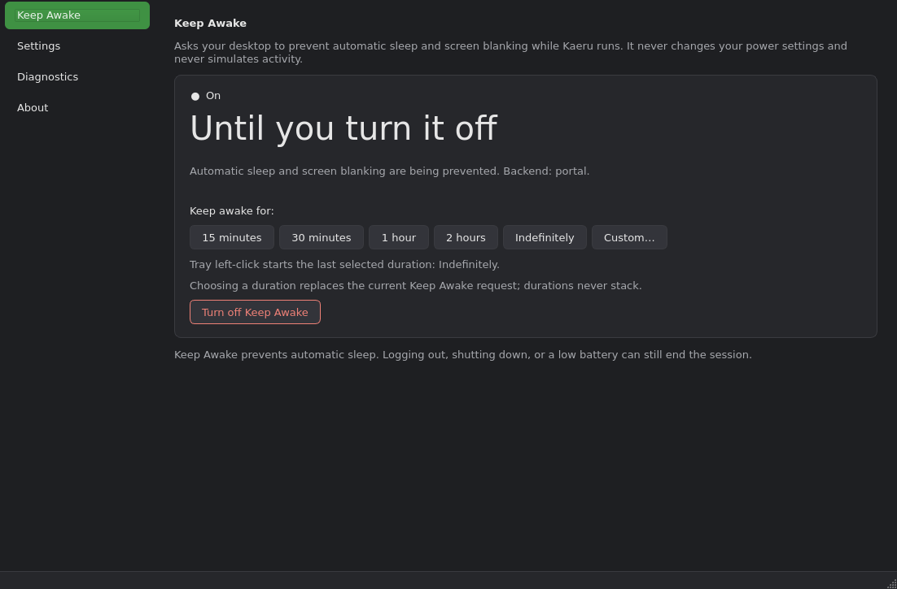
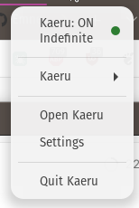
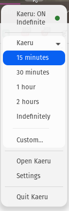
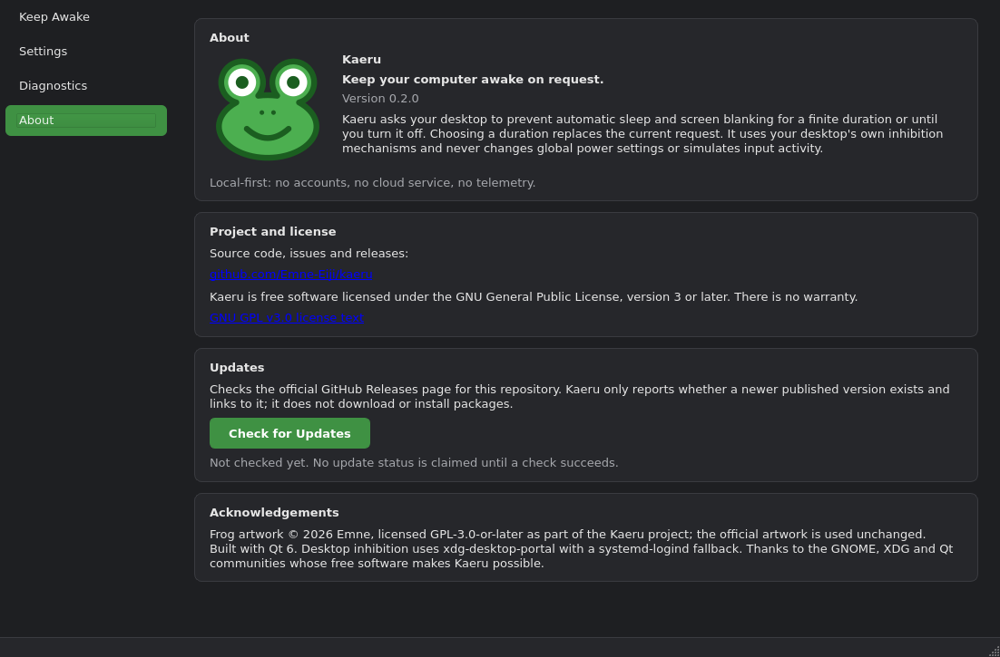

<p align="center">
  
</p>

# Kaeru

**Kaeru** (蛙 — "frog") is a lightweight Qt 6 desktop utility for timed
keep-awake sessions. It asks the desktop to prevent automatic system sleep and
screen blanking for a chosen duration, then releases the request when the time
is up or when you turn it off.

Kaeru is GUI-first and local-first: no account, cloud service, telemetry, or
synthesized input activity. It uses the desktop's own inhibition mechanisms —
`xdg-desktop-portal` Inhibit with a `systemd-logind` fallback — instead of
changing global power settings.

Current release: **0.2.0-3 (Linux Preview)**. See
[Releases](https://github.com/Emne-Eiji/kaeru/releases).

## Why Kaeru?

Laptops and desktops often suspend or blank the screen while a download,
build, or long-running task still needs the machine awake. Changing global
power settings is persistent and easy to forget. Kaeru provides a temporary,
revocable request with an honest view of what the desktop actually confirmed.

## What it does

- **Timed Keep Awake:** 15 minutes, 30 minutes, 1 hour, 2 hours,
  Indefinitely, or a custom finite duration.
- **Custom durations:** whole hours and minutes, from 1 minute to 7 days.
  The same validated selector is used in the GUI and the tray.
- **One active session:** choosing a new duration replaces the current
  request instead of stacking timers.
- **Remembers your last duration:** the last choice survives turning Keep
  Awake off, restarting the app, and rebooting.
- **Honest status:** Kaeru distinguishes a requested session from one the
  desktop confirmed, and shows the active backend and any limitation.
- **Compact tray menu:** live `Kaeru: ON` / `Kaeru: OFF` status with remaining
  time, duration menu, Open Kaeru, Settings, and Quit Kaeru.
- **Four GUI pages:** Keep Awake, Settings, Diagnostics, and About.
- **Themes:** System, Light, and Dark, applied immediately and remembered.
- **Update check:** the About page compares the installed version with the
  official GitHub Releases page and links to the release; it does not install
  packages automatically.

Focus Timer, Work Log, and Reports are deferred in this release. Their source
and existing data are preserved, but they are not exposed in the GUI or CLI.

## Screenshots

| Keep Awake page | Tray status menu |
|---|---|
|  |  |

| Duration menu | About page |
|---|---|
|  |  |

These are unmodified crops of Kaeru running on the tested GNOME session. The
frog artwork is Kaeru's original identity, used unchanged.

## Installation

### Graphical installer (recommended)

1. Download `kaeru_0.2.0-3_amd64.deb` from the
   [Releases page](https://github.com/Emne-Eiji/kaeru/releases).
2. Open the downloaded file in your file manager.
3. Choose **Install** in your distribution's package installer and
   authenticate if prompted.
4. Launch **Kaeru** from the application menu.

The optional `kaeru-dbgsym_*.ddeb` contains debug symbols only. It is not
needed to use Kaeru.

### Terminal alternative (optional)

```bash
sudo apt install ./kaeru_0.2.0-3_amd64.deb
```

A desktop with Qt 6 is required. `xdg-desktop-portal` is recommended; Kaeru
falls back to a logind `sleep:block` inhibitor for system sleep when the
portal is unavailable, but display-awake inhibition requires the portal.

## Usage

### Keep Awake

Open **Kaeru** from the application menu. On the **Keep Awake** page, choose
a duration or open **Custom…** to enter hours and minutes. Selecting a
duration starts a fresh session; selecting another one while active replaces
it. **Turn off Keep Awake** releases the inhibition immediately.

The last selected duration is reused whenever the tray status item starts a
new session. Turning Keep Awake off does not erase that choice.

### Tray

The tray menu is intentionally compact:

- `Kaeru: ON` / `Kaeru: OFF` plus a gray detail line showing remaining time,
  `Indefinite`, or `Inactive`. The status item toggles Keep Awake.
- A `Kaeru` submenu with 15 minutes, 30 minutes, 1 hour, 2 hours,
  Indefinitely, and `Custom…`.
- Open Kaeru, Settings, and Quit Kaeru.

Physical left- and right-click behavior on the tray icon follows the standard
behavior of the desktop environment; some desktops open the menu for both
buttons. The reliable, cross-desktop way to toggle from the tray is the
`Kaeru: ON/OFF` status item in the menu. A left-click on that item always
toggles exactly once.

### Settings and diagnostics

**Settings** offers opt-in autostart switches, notification options, and the
System / Light / Dark appearance selector. **Diagnostics** reports which
inhibition capabilities are available and shows live backend bindings and
paths without exposing private task data.

**About** shows the version, license, acknowledgements, the official
repository link, and a `Check for Updates` action. It never claims the
installed version is current after a failed or unavailable check.

### Command line (optional)

Ordinary use does not require a terminal. For scripting:

```bash
kaeru status --json
kaeru awake on --duration 30m
kaeru awake indefinite
kaeru awake off
kaeru diagnostics --json
```

## Compatibility

| Item | Status |
|---|---|
| Pop!_OS 22.04 (Ubuntu 22.04 base), GNOME 42, X11, Qt 6.2.4 | Tested with the installed 0.2.0-3 package |
| Debian/Ubuntu `.deb` installation on that environment | Tested |
| Ubuntu 24.04 | Not verified |
| Wayland | Not verified |
| Other desktop environments and tray hosts | Not verified |
| Real suspend/resume | Not verified |
| Audible notification playback | Not verified |

See [docs/testing.md](docs/testing.md) and
[docs/capability-matrix.md](docs/capability-matrix.md) for the evidence and
test boundaries.

## Privacy and operation

- No accounts, cloud service, analytics, or telemetry.
- No synthesized keyboard or mouse activity.
- No changes to global power-management settings.
- Configuration is stored locally in Kaeru's own config directory.
- Update checks contact the official GitHub Releases API and only report or
  link; they never download or install packages.

## Known limitations

- Focus Timer, Work Log, and Reports are deferred and remain hidden.
- Physical tray-icon left-click behavior is desktop-dependent and is not a
  supported acceptance requirement; use the menu status item to toggle.
- GNOME's DBusMenu renders plain text, so the status dot carries green/red
  state color and the text itself remains the panel's normal text color.
- The first release is a pre-release because Ubuntu 24.04, Wayland, and real
  suspend/resume have not been validated.
- There is currently no published stable release; `Check for Updates`
  reports that the update status is unknown rather than claiming success.

## License and acknowledgements

Kaeru is free software licensed under the **GNU GPL v3 or later**. See
[LICENSE](LICENSE) for the full text and
[debian/copyright](debian/copyright) for package-level notices.

The original frog artwork is © 2026 Emne and is licensed under the same
GPL-3.0-or-later terms as the project. It is used unchanged. Kaeru is built
with Qt 6 and relies on xdg-desktop-portal, systemd-logind, and the work of
the GNOME, XDG, and Qt communities.

## Issues and contributions

Please report bugs and feature requests in the
[issue tracker](https://github.com/Emne-Eiji/kaeru/issues). Contributions are
welcome through issues and pull requests; repository conventions are in
[AGENTS.md](AGENTS.md). For substantial changes, please open an issue first.

## Documentation

- [Testing and acceptance evidence](docs/testing.md)
- [Technical architecture](docs/handoff/KAERU_TECHNICAL_ARCHITECTURE.md)
- [Open issues and limitations](docs/handoff/KAERU_OPEN_ISSUES.md)
- [Icon assets and provenance](docs/icon-assets.md)
- [Privacy notes](docs/privacy.md)
- [Release downloads](https://github.com/Emne-Eiji/kaeru/releases)
